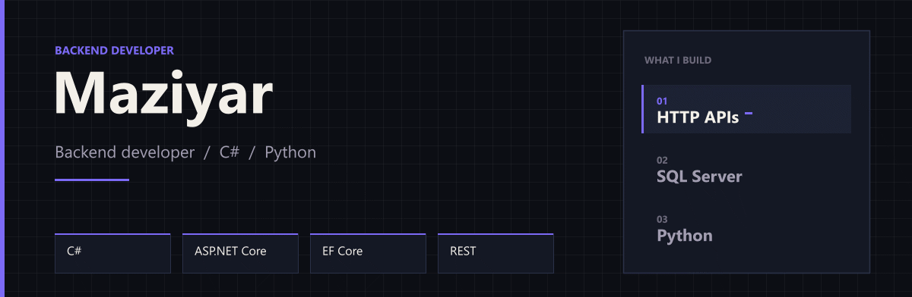

  

Backend developer. I build server-side software in C# and ASP.NET Core, and I use Python as well. Three years of programming, most of it on APIs and the database behind them.

## Selected work

### [TaskManagement API](https://github.com/CallMeMazi/TaskManagement-API)

A .NET 10 API for organizations, projects, and tasks.

The rules live on the domain model. Each use case is a MediatR request, and FluentValidation checks the input before anything is saved. Entity Framework Core stores the application in SQL Server and writes logs to a second database. Sign-in is a token, with a separate session for each device.

  
  
  
  

### [PersonalFinance](https://github.com/CallMeMazi/PersonalFinance)

A local personal-finance app. The interface is Persian, dates use the Jalali calendar, and the records stay in SQL Server on ASP.NET Core MVC.

  
  

## Stack

| | |
|---|---|
| **Languages** | C#, Python |
| **Backend** | ASP.NET Core, REST, Entity Framework Core |
| **Data** | SQL Server |
| **Practice** | Git, layered structure, validation, authentication |

  <a href="https://github.com/CallMeMazi?tab=repositories">All repositories</a>

